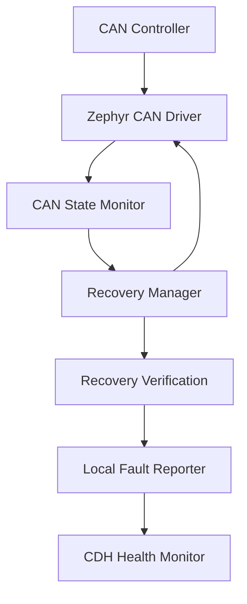

\---

title: CAN Bus-Off Detection and Recovery

sidebar\_position: 6

\---

\# CAN Bus-Off Detection and Recovery

\*\*Status:\*\* Proposed architecture — waiting to review this with the team

\## Purpose

The CAN Bus-Off Recovery Manager is responsible for detecting when a local CAN controller enters the bus-off state, coordinating its recovery, and reporting the outcome.

This supports UT-CORE's fault detection, isolation, and recovery (FDIR) strategy.

\## Software Component Diagram

The proposed recovery architecture separates local CAN controller recovery from system-level health monitoring. Each participating board detects and handles its own CAN controller errors through the Zephyr driver. Recovery verification checks controller state and communication health independently. Fault information is recorded locally and reported to CDH when communication is available. CDH separately monitors subsystem availability and can escalate persistent communication failures through the spacecraft's FDIR policies.

Each CAN-enabled board should be considered for local recovery handling. CDH monitors subsystem communication and handles higher-level fault escalation.

\## Responsibilities

| Component | Responsibility |

|---|---|

| CAN State Monitor | Detect CAN controller error states, including bus-off |

| Recovery Manager | Coordinate controller recovery and bounded retries |

| Recovery Verification | Check whether the controller and communication have recovered |

| Fault Reporter | Record fault events and recovery outcomes |

| CDH Health Monitor | Track subsystem availability and persistent communication failures |

\## Inputs and Outputs

| Input | Output |

|---|---|

| CAN controller state | Recovery status |

| Bus-off notification | Recovery request |

| Recovery API result | Success or failure event |

| Retry policy | Retry or escalation decision |

| Communication health | Updated health information |

\## Proposed Recovery States

\- NORMAL: Controller is operational.

\- BUS\_OFF: Controller has entered bus-off.

\- RECOVERING: Recovery is underway.

\- VERIFYING: Controller and communication health are checked.

\- RETRY\_WAIT: Waiting before another permitted attempt.

\- FAILED: Recovery attempts exhausted or an unrecoverable error occurred.

\## Implementation Plan

1\. Inspect the existing Zephyr CAN initialization and communication code.

2\. Determine which boards support automatic and manual bus-off recovery.

3\. Register a CAN state-change callback where supported.

4\. Implement recovery handling outside interrupt-sensitive callback contexts.

5\. Track recovery attempts and fault status.

6\. Verify controller recovery and application-level communication.

7\. Report recovery outcomes to the local health system and CDH when communication is available.

\## Verification Plan

| Test | Expected result |

|---|---|

| Normal CAN traffic | No unnecessary recovery |

| Injected bus-off condition | Fault detected and recorded |

| Successful recovery | Controller returns to operational state |

| Repeated recovery failure | Bounded retries and escalation |

| Communication restored | Application-level messages resume |

| Persistent node silence | CDH records a communication fault |

\## Open Design Questions

\- Which boards require a local recovery manager?

\- Is automatic CAN recovery enabled in the current Zephyr configuration?

\- What retry limits and timeouts should be used?

\- What existing telemetry message can report recovery status?

\- Which faults should trigger CDH escalation?
